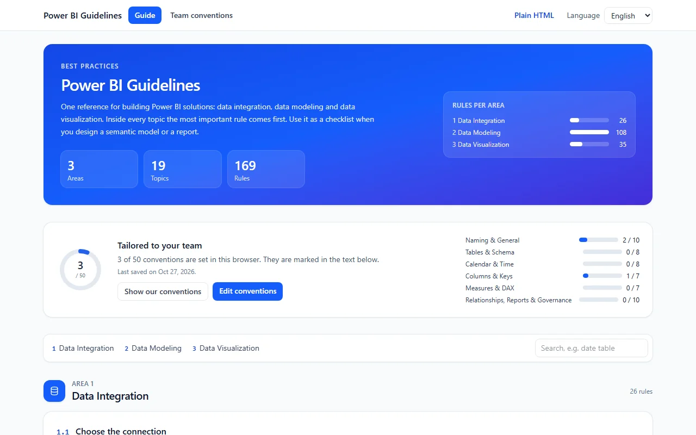

# Power BI Guidelines

The Power BI guidelines and best practices as a Fabric App: one reference for data integration, data modeling and data visualization, tailored to your team's own conventions in the browser.



## What it does

- **The guide.** Three areas, 19 topics and 169 rules, the most important rule first in every topic, with 26 drawings that show the good and the bad version side by side. Search runs over the whole text.
- **Your team's conventions.** Fifty optional questions (naming, modeling, calendar, columns, measures, reports). The answers are filled into the rules and marked, so the guide says "your team names the measure table *Kennzahlen*" instead of a generic example.
- **Kept in the browser, shared as a file.** Answers are saved in the browser's local storage. Export them as a JSON file to pass them around; import a file to apply a team's conventions. Files exported by the Power BI Fixer questionnaire import too. Imported files are treated as untrusted: only known questions, offered choices and bounded text are kept.
- **A plain HTML version.** The build also writes the guide as one self-contained HTML file per language: no script, nothing loaded from the internet, opens offline, prints with a page per area. The header link "Plain HTML" opens it.
- **English and German**, switchable in the header.

There is no sign-in inside the app, no database and no access management. Nothing a person types leaves their browser unless they export it.

## Fabric architecture

Deploys into your workspace:

| Item | Why |
|---|---|
| Static web app | the guide, the questionnaire and the two plain HTML files |
| Entra sign-in | enabled because the platform expects it; the app itself never asks for it |

No SQL database, no lakehouse, no functions. `staticHosting.assetAccess` is `public`: anyone with the link gets the files, which hold the guide and nothing else.

## Getting started

```bash
npm install
npm run dev                 # http://localhost:5173
npm run build               # dist/ with the app and both plain HTML files
npx rayfin up --workspace-id <your-workspace-guid> --tenant <your-tenant-guid>
```

Run `npx rayfin up --dry-run ...` first and check that it plans a new item named `power-bi-guidelines` in the workspace you meant. Any workspace or item id is passed on the command line. There is no default: a default that usually works is how a script writes to somebody else's workspace.

After the first deployment, `rayfin up` adds your app host to `rayfin/rayfin.yml`. Keep it out of anything you publish.

## Project structure

```
src/components/   the guide page, the questionnaire and the shared guide body
src/guidelines/   content (EN and DE), questions, drawings, the answer sanitizer and the browser store
src/html/         the plain HTML page and its renderer
src/i18n/         the two string catalogues
tools/            build-html.mjs, which writes the plain HTML files
rayfin/           deployment config; redirect URIs are loopback only
```

## Scripts

| Script | What it does |
|---|---|
| `npm run dev` | dev server |
| `npm run build` | type check, app build and the plain HTML files |
| `npm run build:fabric` | the same, used by `rayfin up` |
| `npm run build:html` | only the plain HTML files, from the last app build |
| `npm run test` | unit tests |
| `npm run lint` | lint |

## Data

None is bundled and none is collected. The guide is text written for this app. The numbers in the drawings are made up, and the drawings say so. A team's answers live in each person's browser and in the files they choose to export.

## Credits

The rules are adapted from the Power BI guidelines of the [Power BI Fixer](../pbi-fixer/) in this repository and from the [Tabular Style Guide](https://www.elegantbi.com/post/tabularstyleguide) by Michael Kovalsky (Elegant BI). The guide was first built as a tab of the [Fabric User Manager](../governance-hub/).

Built on [Rayfin](https://github.com/microsoft/awesome-rayfin) and the Fabric platform. Licence: [LICENSE](LICENSE).
