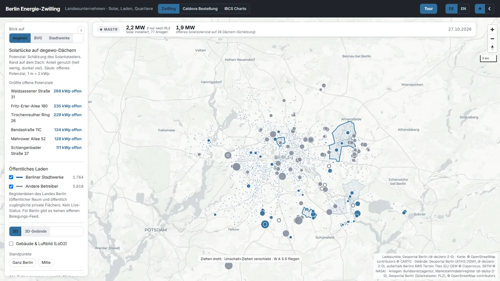

# Berlin Energy Twin

**Solar, public charging and housing estates of Berlin's state-owned companies on one 1:1 map.**



A Microsoft Fabric App (preview) that shows where Berlin's municipal energy, housing and public
transport companies already produce solar power, where roof potential is still open, and how well
housing estates are served by public charging. Everything comes from open data and every figure
is computed in the app from the baked files. The UI is German with a full English switch.

Two more tabs show a fictional pharma wholesaler (Caldova) as a Fabric App pattern: an order app
that writes reorders to the app's own SQL database, and an IBCS finance cockpit.

## What it does

- **Three lenses.** Housing (focus), public transport and municipal energy. Each lens frames its
  sites, lists the largest open roof potentials and shows installed solar from the Marktstammdatenregister.
- **Roof gaps in 3D, at true size.** On LoD2 buildings with TrueDOP 2025 roof photos, a band on
  the roof shows the share already used and a label the open kWp. Buildings, trees and terrain are
  strictly 1:1, nothing is exaggerated. Sites load lazily, at most four at a time.
- **Public charging near the estates.** All public charge points of Berlin, with the municipal
  energy company's points highlighted, the 300 m reach of each housing estate and the one estate
  without a point from that operator.
- **Charging per district.** The 12 districts shaded by public charge points per 1,000
  residents, with the municipal energy company's share and public charging energy per year in the popup.
- **Guided tour.** Ten stops built from the data and the live feeds (solar now, districts, 1:1 roof, live public transport, the report), presenter keys, flights timed by distance.
- **Live public transport.** Buses, trams, U-Bahn and ferries in the camera view every 30 s from the
  community radar `v6.bvg.transport.rest` (computed positions, unofficial source, badged so).
- **Solar now.** An estimate of what each partner's solar produces right now: DWD irradiance
  (nearest station measuring it, via Bright Sky) × installed kWp × performance ratio 0.8, badged
  as estimate, "no measurement" at night.
- **DGM1 terrain** for the whole city with a subtle hillshade, in 2D and 3D.
- **Caldova orders.** The original caldova-reorder screens with a baked snapshot; signed-in users
  in the Fabric portal place reorders that land in the app's SQL database.
- **IBCS Charts.** KPI cockpit and P&L with simulation, based on Michael Tenner's IBCS Finance
  Cockpit, answered from a baked snapshot of its semantic model.
- **Report window.** The import model and its report published to the workspace
  (`python tools/fabric/publish_pbip.py`: refresh, agreement check against the app's figures,
  folder), shown in a Power BI window over the map whose page follows the lens. The tenant and
  report ids live in an untracked `tools/fabric/powerbi.json`; without it there is no button.
- **Import model for Copilot.** `fabric/` holds a portable Power BI project (PBIP) with the twin's
  data embedded in the model, German names, descriptions, Copilot instructions and a 4-page report.

## Architecture

```
open data (Geoportal Berlin WFS/WMS/Atom, MaStR, OSM)
      │  tools/*.py bakes (Python)
      ▼
public/data/*.json|bin|webp ──► React + MapLibre app (Vite) ──► Fabric App static hosting
                                     │                              (assetAccess: protected)
                                     ├─ Caldova orders ──► Rayfin data API ──► app SQL database
                                     └─ live: public transport radar (30 s), DWD irradiance via Bright Sky (10 min)
app functions ──► tools/export_model_data.ts ──► fabric/gen_model.py ──► PBIP (import model)
```

- Static hosting with `assetAccess: protected`: only signed-in Fabric users can open it.
- No Functions and no connector, so the app stays open to every user with access (a delegated
  connector would make it owner-only).
- The main bundle ships gzip-compressed and is unpacked by a small inline loader
  (`tools/gzip_bundle.mjs`), so the whole app is one module file.

## Getting started

```bash
npm ci
```

```bash
npm run dev
```

The aerial photos are not in this repository (media budget). Bake them once, they come from the
Geoportal Berlin TrueDOP 2025 WMS (DL-DE-Zero 2.0):

```bash
npm run bake:aerial
```

The bake scripts run from a Python environment one folder up (`../.venv`) with `numpy`,
`pandas`, `scipy`, `shapely`, `pyproj` and `Pillow`.

Deploy to your own workspace with the Rayfin CLI:

```bash
npx rayfin up --tenant <tenant-id> --workspace-id <workspace-id>
```

Without a deployment the order tab runs read-only and says so.

## Project structure

| Path | What |
|---|---|
| `src/` | the twin (map, lenses, tour, buildings, terrain) |
| `src/reorder/`, `src/nachbestellung/` | Caldova order screens and their live data path |
| `src/finanzen/` | IBCS finance cockpit (Michael Tenner's cockpit, ported) |
| `rayfin/` | Rayfin app config and the `RestockRequest` table |
| `public/data/` | baked open data, terrain tiles and the two Caldova snapshots |
| `tools/` | bakes, bundle compression, headless probes |
| `fabric/` | import model generator and the PBIP (model + report) |

## Scripts

| Script | What |
|---|---|
| `npm run dev` | dev server on port 5290 |
| `npm run build` | type check, build, gzip data and bundle |
| `npm test` | twin unit tests, then the specs of the two Caldova tabs (jsdom) |
| `npm run bake:*` | re-bake one data source (`charging`, `mastr`, `sites`, `context`, `aerial`, `terrain`, `buildings`) |
| `npm run probe` / `probe:tour` | headless Edge screenshots of a view or the tour |
| `node tools/probe_tabs.mjs` | headless check of the two Caldova tabs |
| `node tools/sweep.mjs` | Playwright sweep of the whole app on three viewport sizes |
| `npm run export:model` | write the import model's CSVs from the app's own functions |

## Data

Open data only; see [ATTRIBUTION.md](ATTRIBUTION.md) for every file, source and licence.
Marktstammdatenregister units are filtered to legal entities, so no private person's unit is
stored. Estimates (roof potential, district values) are badged as estimates in the app. The
Caldova company, its pharmacies, orders and finance figures are fictional.

## Credits

- Open data: Geoportal Berlin (DL-DE-Zero 2.0), Bundesnetzagentur Marktstammdatenregister
  (DL-DE-BY 2.0), © OpenStreetMap contributors (ODbL), Statistics Office Berlin-Brandenburg,
  DWD via Bright Sky. Basemap © CARTO.
- IBCS Finance Cockpit and its visuals: Michael Tenner (DatenWG), MIT, see
  `src/finanzen/LICENSE.datenwg` and `src/finanzen/SOURCE.md`. IBCS® is a registered trademark of
  the IBCS Institute; the pages are based on IBCS, not certified.
- Caldova order screens: caldova-reorder (Microsoft, MIT), see `LICENSE-caldova-reorder`.
- Report visuals: IBCS Multi-Tier Bar and Column by Alexander Korn.
